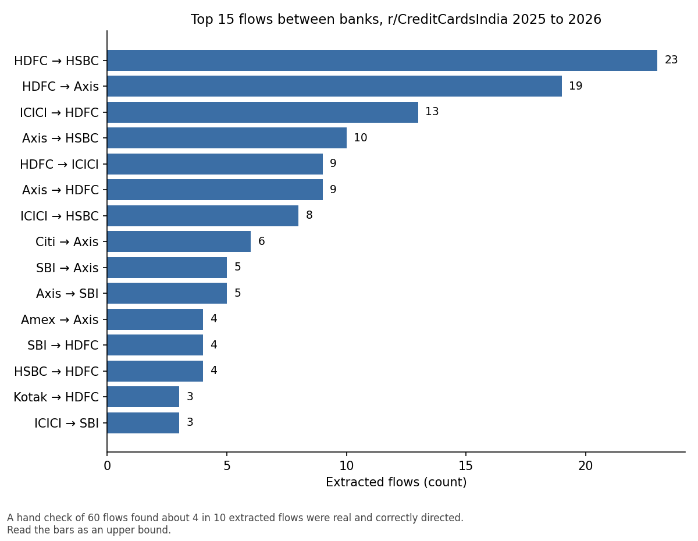

# Brand-Switch Analysis on r/CreditCardsIndia

Banks can see who cancels a credit card. They usually can't see where those customers go next, because that story only exists as free text in forums. I wanted to know if public posts could recover it, so I pulled about 270,000 posts and comments from r/CreditCardsIndia and built a pipeline that turns switch stories into a map of which bank people move from and to.

The short version: the pipeline works well enough to show the idea, and not well enough to publish conclusions. After filtering, I estimate roughly 80 real, correctly directed switches between banks, and I only know that because I checked a sample by hand. This repo is as much about that check as about the pipeline.



*Top 15 extracted flows between banks. About 4 in 10 extracted flows were real and correctly directed in my hand check, so read the bars as an upper bound.*

## What the pipeline produced

| Stage | Count |
|---|---|
| Posts and comments pulled | 270,718 (posts Jan 2025 to Oct 2026, comments Jul to Oct 2026) |
| After cleaning (removed posts, bots, very short text, duplicates) | 236,117 |
| Mention a bank or card | 144,151 |
| Possible switch stories (switch wording plus a bank name) | 20,258 |
| Directed flows left after dropping questions, plans and negations | 791 |
| Between two different banks | 179 |
| Within one bank (card upgrades) | 612 |

- **Biggest moves between banks:** HDFC to HSBC (23), HDFC to Axis (19), ICICI to HDFC (13), Axis to HSBC (10).
- **Most movement stays inside one bank.** 612 of 791 flows are card upgrades within the same bank, 418 of them HDFC. I did not hand-check these, and many are bank-initiated upgrade offers rather than customer choices.
- **Topics:** BERTopic on the 745 posts and comments behind the flows found 17 topics, with 30% left unassigned. Most are card families and upgrade offers (HDFC Millennia and MoneyBack, ICICI Coral to Sapphiro to Rubyx, Axis Flipkart and Atlas). One theme is premium banking tied to salary accounts. The examples I read were people moving salary accounts from Axis Burgundy or HDFC Imperia to HSBC Premier after poor relationship manager service or to meet a salary threshold.

## How reliable is this

I read 60 randomly picked between-bank flows and judged each one. The post text is left out of the repo, but my labels and a short reason for each are in `results/hand_check_60_flows.csv`.

- For 46 of the 60, the sentence behind the flow was visible. 22 were real switches (48%), and 20 of those had the right direction (91%).
- That means about 43% of extracted flows were real and correctly directed. The other 14 rows were long posts where the key sentence was cut off in my sample file, so I did not judge them. Counting all 60, the range is 33% to 57%.
- Applied to the 179 between-bank flows, that suggests roughly 80 real flows, plausibly 50 to 100.
- The HDFC to HSBC flow held up best (9 of 14 correct), mostly salary-account moves. HDFC to Axis was 4 of 7.

What went wrong in the flows that were not correct:

- Advice and plans read as switches ("should I replace", "will be moving").
- A card change inside one bank read as a move between banks (an Axis Myzone to Privilege conversion became Axis to Amex, because Privilege runs on the Amex network).
- One direction was reversed, and one post appeared twice.
- The "instead of" rule was right 0 times in 6.

## What I would not claim

- **Not market share.** People who post about switching are not a random sample of people who switch.
- **Recall is unknown.** I measured how many extracted flows are right, not how many real switches the rules miss. Switching may be rare in this subreddit, or the rules may be missing most of it. I have not separated the two.
- **Zero-shot did little of the work.** About 83% of the flows came from posts the zero-shot model labeled "other". The hand-written direction rules do most of the work, and zero-shot mostly removes clear plans and comparisons.
- **Comments only cover Jul to Oct 2026.** Anything about change over time uses posts only.
- **Banks, not cards.** Cards are rolled up to their bank (Regalia counts as HDFC), so moves between two cards of one bank appear as within-bank flows.

## What I would do next

1. Measure recall by hand-labeling a sample of the records the keyword filter rejected.
2. Replace the regex direction rules with an LLM extractor and score it against the 60 hand-checked rows plus a fresh sample.
3. Drop the "instead of" rule and remove duplicate posts.
4. Pull comments evenly across quarters so trends can be compared.

## How it works

| Step | File | What it does |
|---|---|---|
| 1 | `01_collect_data.py` | Pulls posts and comments from the Arctic Shift Reddit archive, newest first, resumable |
| 2 | `02_clean_and_candidates.py` | Cleans, matches bank and card names, keeps records with switch wording |
| 3 | `03_zero_shot.py` | Zero-shot classifier (DeBERTa) labels each record: switched, considering, comparing, other |
| 4 | `04_flows_and_sankey.py` | Direction rules read wording like "from X to Y", drop questions and plans, count the flows |
| 5 | `05_bertopic.py` | Groups the switch stories into topics |

`02_clean_and_candidates.py` has a `LEGACY_FILTER` flag. `True` is the setting behind every number above. Setting it to `False` uses a wider list of card names and gives different counts. Step 4 always uses the wider name list.

`results/` holds the small outputs: `sankey_data.csv` (From and To counts, formatted for a Sankey visual in Power BI), `flows.csv`, `topics_summary.csv` and the hand-check file.

## Run it

```
pip install -r requirements.txt
python 01_collect_data.py           # hours, can be stopped and resumed
python 02_clean_and_candidates.py
python 03_zero_shot.py              # needs a GPU, use Colab or Kaggle
python 04_flows_and_sankey.py
python 05_bertopic.py
```

Each script reads the previous step's output from the same folder. Step 3 and step 5 ran on a Colab runtime.

## Data

The text is public Reddit content from the Arctic Shift archive. Raw posts, comments and usernames are not in this repo.
